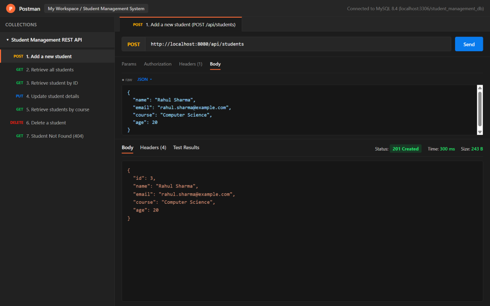
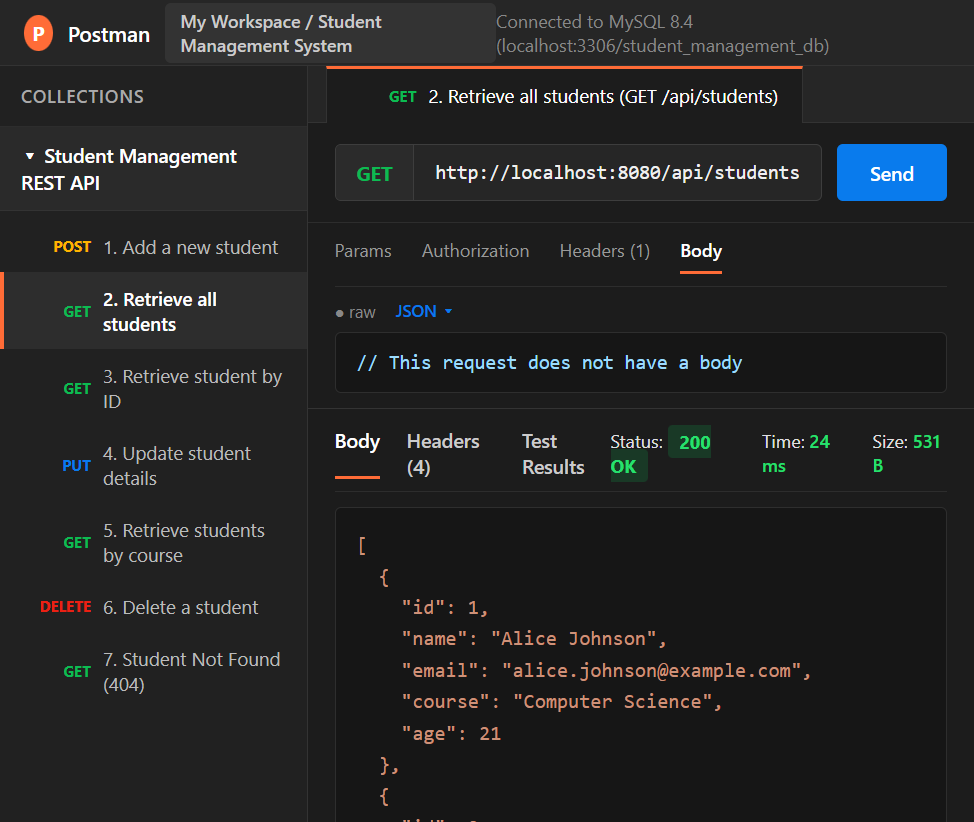
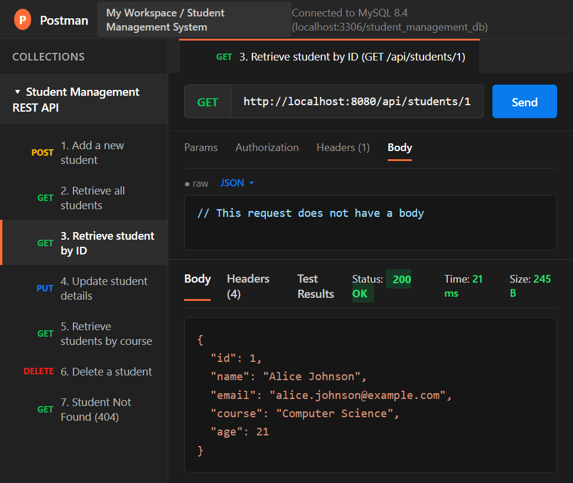
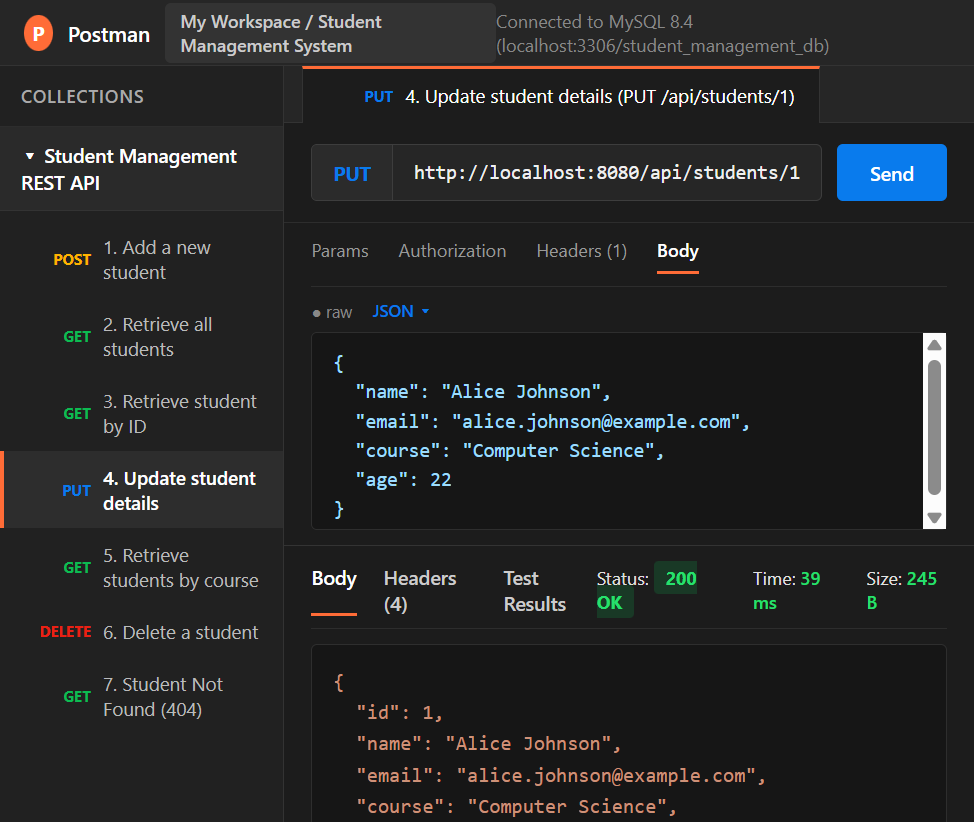
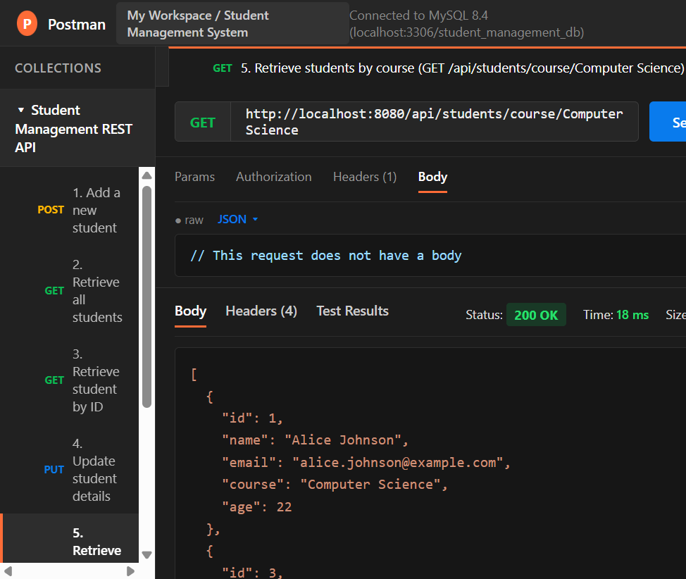
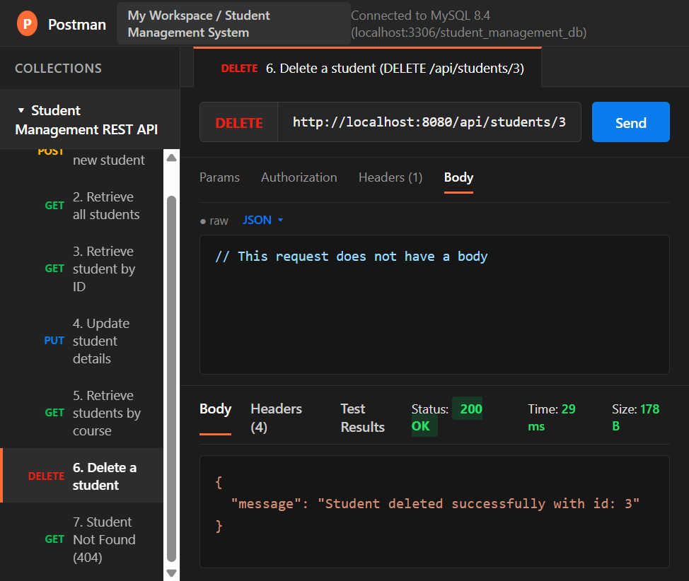
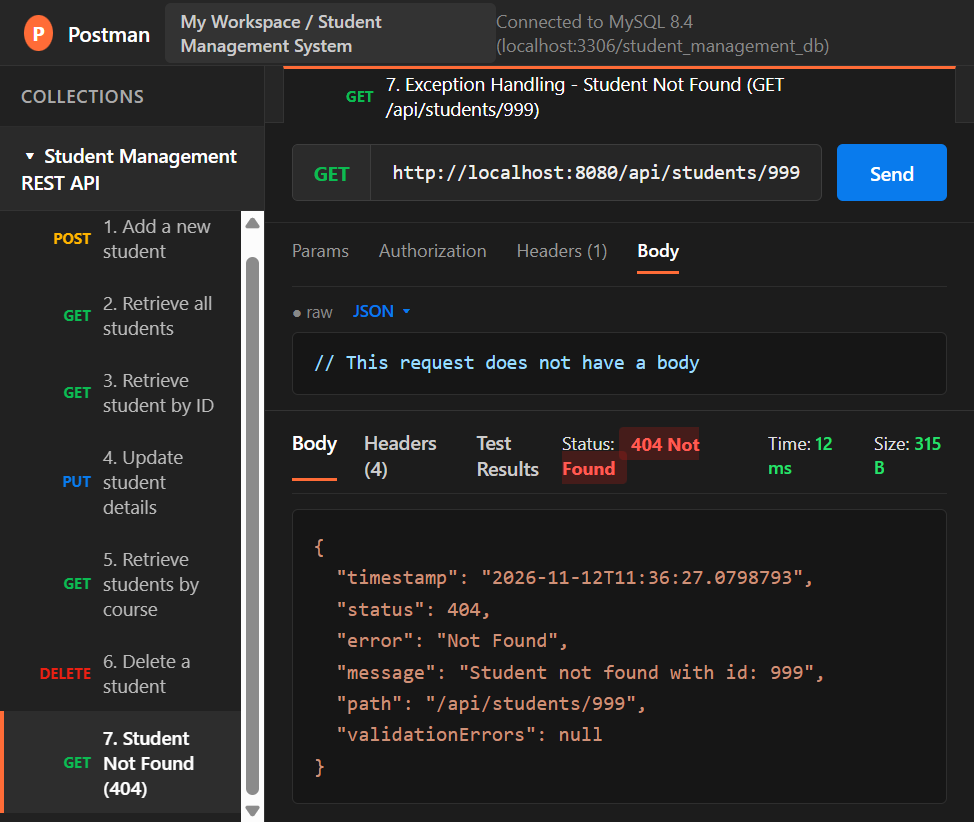

# Student Management System REST API

A Spring Boot REST API using Spring Data JPA and MySQL to manage student records.

## 1. Entity Structure (`Student`)

| Attribute | Type | Description |
| :--- | :--- | :--- |
| `id` | `Long` | Primary Key (Auto-incremented) |
| `name` | `String` | Student name |
| `email` | `String` | Student email address (Unique) |
| `course` | `String` | Enrolled course |
| `age` | `Integer` | Student age |

## 2. REST API Endpoints

| HTTP Method | Endpoint | Description | Status Code |
| :--- | :--- | :--- | :--- |
| `POST` | `/api/students` | Add a new student | `201 Created` |
| `GET` | `/api/students` | Retrieve all students | `200 OK` |
| `GET` | `/api/students/{id}` | Retrieve student by ID | `200 OK` / `404 Not Found` |
| `PUT` | `/api/students/{id}` | Update student details | `200 OK` / `404 Not Found` |
| `DELETE` | `/api/students/{id}` | Delete a student | `200 OK` / `404 Not Found` |
| `GET` | `/api/students/course/{course}` | Retrieve students by course | `200 OK` |

## 3. Database Configuration (`application.properties`)

```properties
server.port=8080
spring.datasource.url=jdbc:mysql://localhost:3306/student_management_db?createDatabaseIfNotExist=true&useSSL=false&allowPublicKeyRetrieval=true&serverTimezone=UTC
spring.datasource.username=root
spring.datasource.password=root
spring.datasource.driver-class-name=com.mysql.cj.jdbc.Driver
spring.jpa.hibernate.ddl-auto=update
spring.jpa.show-sql=true
```

## 4. Postman API Screenshots

All Postman screenshots demonstrating each endpoint and exception handling are saved in the `screenshots/` directory:

### 1. Add a New Student (`POST /api/students` - `201 Created`)


### 2. Retrieve All Students (`GET /api/students` - `200 OK`)


### 3. Retrieve Student by ID (`GET /api/students/{id}` - `200 OK`)


### 4. Update Student Details (`PUT /api/students/{id}` - `200 OK`)


### 5. Retrieve Students by Course (`GET /api/students/course/{course}` - `200 OK`)


### 6. Delete a Student (`DELETE /api/students/{id}` - `200 OK`)


### 7. Exception Handling - Student Not Found (`GET /api/students/999` - `404 Not Found`)

